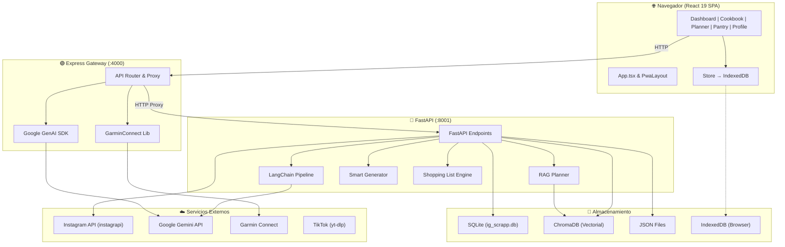
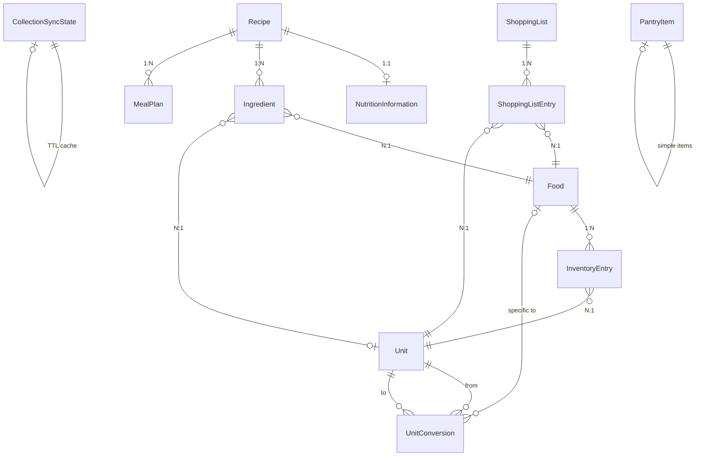
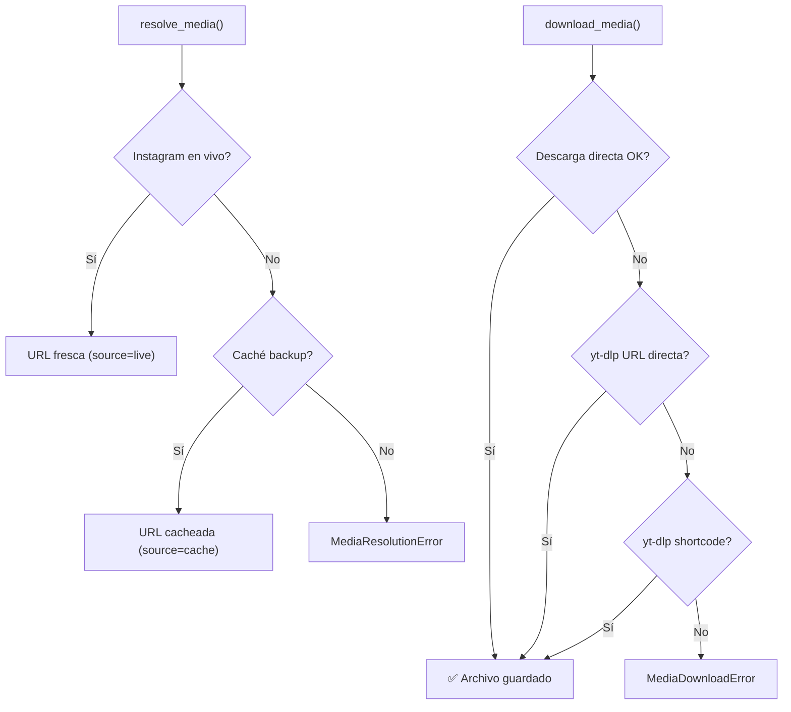
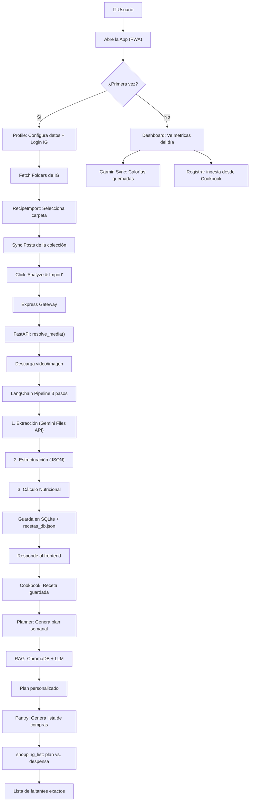

# 📚 Documentación Técnica Completa — NutriSnap AI

> **Proyecto:** `ig-scrapp-app` (NutriSnap AI)
> **Versión:** 1.0
> **Fecha:** 2026-09-24
> **Repositorio:** `valarcon1226/ig-mealplan-rag`

---

## Índice

1. [Visión General](#1-visión-general)
2. [Arquitectura del Sistema](#2-arquitectura-del-sistema)
3. [Stack Tecnológico](#3-stack-tecnológico)
4. [Backend (FastAPI + Python)](#4-backend-fastapi--python)
   - 4.1 [Servidor Principal — ig_recetas.py](#41-servidor-principal--ig_recetaspy)
   - 4.2 [Pipeline de IA — langchain_pipeline.py](#42-pipeline-de-ia--langchain_pipelinepy)
   - 4.3 [Modelos de Datos — models.py](#43-modelos-de-datos--modelspy)
   - 4.4 [Base de Datos — database.py](#44-base-de-datos--databasepy)
   - 4.5 [Persistencia de Recetas — recipe_store.py](#45-persistencia-de-recetas--recipe_storepy)
   - 4.6 [Base Vectorial — vector_db.py](#46-base-vectorial--vector_dbpy)
   - 4.7 [Planificador RAG — rag_planner.py](#47-planificador-rag--rag_plannerpy)
   - 4.8 [Chatbot RAG — rag_chatbot.py](#48-chatbot-rag--rag_chatbotpy)
   - 4.9 [Servicio de Planes — mealplan_service.py](#49-servicio-de-planes--mealplan_servicepy)
   - 4.10 [Generador Heurístico — smart_generator.py](#410-generador-heurístico--smart_generatorpy)
   - 4.11 [Lista de Compras — shopping_list.py](#411-lista-de-compras--shopping_listpy)
   - 4.12 [Mealprep por Sesiones — mealprep_planner.py](#412-mealprep-por-sesiones--mealprep_plannerpy)
5. [Módulos Auxiliares del Backend](#5-módulos-auxiliares-del-backend)
   - 5.1 [Autenticación Instagram — ig_auth.py](#51-autenticación-instagram--ig_authpy)
   - 5.2 [Colecciones Instagram — ig_collections.py](#52-colecciones-instagram--ig_collectionspy)
   - 5.3 [Descargador — ig_downloader.py](#53-descargador--ig_downloaderpy)
   - 5.4 [Resolución de Media — ig_media.py](#54-resolución-de-media--ig_mediapy)
   - 5.5 [Normalización de Ingredientes — ingredient_normalizer.py](#55-normalización-de-ingredientes--ingredient_normalizerpy)
   - 5.6 [Utilidades de Video — video_utils.py](#56-utilidades-de-video--video_utilspy)
6. [Frontend (React + TypeScript)](#6-frontend-react--typescript)
   - 6.1 [Estructura y Enrutamiento — App.tsx](#61-estructura-y-enrutamiento--apptsx)
   - 6.2 [Estado Global — store.tsx](#62-estado-global--storetsx)
   - 6.3 [Tipos — types.ts](#63-tipos--typests)
   - 6.4 [Calculadora de Macros — macroCalculator.ts](#64-calculadora-de-macros--macrocalculatorts)
   - 6.5 [Páginas de la Aplicación](#65-páginas-de-la-aplicación)
   - 6.6 [Servidor Express (API Gateway) — server.ts](#66-servidor-express-api-gateway--serverts)
7. [API Reference (Endpoints Completos)](#7-api-reference-endpoints-completos)
8. [Base de Conocimiento Nutricional](#8-base-de-conocimiento-nutricional)
9. [Configuración y Variables de Entorno](#9-configuración-y-variables-de-entorno)
10. [Diagrama de Flujo Completo](#10-diagrama-de-flujo-completo)
11. [Decisiones de Diseño y Solución de Problemas](#11-decisiones-de-diseño-y-solución-de-problemas)
12. [Scripts Utilitarios](#12-scripts-utilitarios)
13. [Guía de Instalación y Ejecución](#13-guía-de-instalación-y-ejecución)

---

## 1. Visión General

**NutriSnap AI** es una aplicación full-stack de nutrición inteligente que permite:

1. 🎥 **Extraer recetas de Instagram/TikTok** — Analiza videos y posts con IA multimodal (Google Gemini) para convertirlos en recetas estructuradas con macronutrientes calculados.
2. 📖 **Recetario inteligente (Cookbook)** — Catálogo visual de recetas guardadas con búsqueda en tiempo real.
3. 🗓️ **Planificador de comidas con IA (Planner)** — Genera planes diarios o semanales personalizados usando RAG (Retrieval-Augmented Generation) sobre las recetas del usuario.
4. 🛒 **Lista de compras determinística (Grocery List)** — Calcula exactamente qué ingredientes faltan comparando el plan contra la despensa.
5. 📊 **Dashboard nutricional** — Panel de control diario con balance energético, racha de uso y sincronización con Garmin Connect.
6. 🤰 **Adaptaciones clínicas** — Ajustes automáticos por ciclo menstrual, embarazo y metas de composición corporal.

---

## 2. Arquitectura del Sistema



### Capas de la Arquitectura

| Capa | Tecnología | Responsabilidad |
|------|-----------|----------------|
| **Presentación** | React 19 + Tailwind CSS 4 | UI tipo PWA en modo oscuro |
| **API Gateway** | Express.js + Node.js | Proxy reverso, Gemini SDK directo, Garmin |
| **API Backend** | FastAPI (Python) | Lógica de negocio, scraping, pipelines IA |
| **IA Multimodal** | LangChain + Google Gemini | Extracción, estructuración, cálculo nutricional |
| **Búsqueda Semántica** | ChromaDB + SentenceTransformers | Embeddings y búsqueda vectorial para RAG |
| **Relacional** | SQLAlchemy + SQLite | Recetas, ingredientes, despensa, planes |
| **Persistencia Cliente** | IndexedDB (idb-keyval) | Estado offline-first del usuario |

---

## 3. Stack Tecnológico

### Backend (Python)
| Paquete | Versión | Uso |
|---------|---------|-----|
| FastAPI | - | Framework de API REST |
| instagrapi | - | Scraping de Instagram (Private API) |
| LangChain | ≥ 0.3.0 | Orquestación de pipelines de IA |
| langchain-google-genai | ≥ 2.0.0 | Integración con Gemini |
| Pydantic | ≥ 2.0.0 | Validación de esquemas |
| SQLAlchemy | - | ORM para SQLite |
| ChromaDB | - | Base de datos vectorial |
| SentenceTransformers | - | Modelo `all-MiniLM-L6-v2` para embeddings |
| OpenCV (cv2) | - | Extracción de fotogramas de video |
| yt-dlp | - | Descarga de videos (TikTok, fallback IG) |

### Frontend (TypeScript/Node.js)
| Paquete | Versión | Uso |
|---------|---------|-----|
| React | 19.0.1 | UI framework |
| react-router-dom | 7.15.1 | Enrutamiento SPA |
| Tailwind CSS | 4.1.14 | Estilos utility-first |
| Express | 4.21.2 | API Gateway / servidor |
| @google/genai | 2.4.0 | Gemini SDK directo |
| garmin-connect | 1.6.2 | Integración Garmin |
| idb-keyval | 6.2.4 | IndexedDB simplificado |
| lucide-react | 0.546.0 | Iconografía |
| date-fns | 4.3.0 | Manipulación de fechas |
| react-datepicker | 9.1.0 | Selector de fechas |
| Vite | 6.x | Build tool & dev server |

---

## 4. Backend (FastAPI + Python)

### 4.1 Servidor Principal — [ig_recetas.py](file:///c:/Users/valentina.alarcon/Documents/Cursos/Claudia/Portafolio/ig-scrapp-app/backend/ig_recetas.py)

El archivo más extenso del proyecto (~48KB, ~1100+ líneas). Es el **orquestador central** de toda la API REST.

**Responsabilidades:**
- Autenticación con Instagram
- Sincronización y descarga de carpetas guardadas
- Análisis multimodal directo y por LangChain (video/imagen → receta)
- Almacenamiento de recetas en JSON y SQLite
- Generación de planes de alimentación (RAG + heurístico)
- Gestión de despensa y lista de compras
- Tareas asíncronas en background
- Importación de recetas desde TikTok

**Funciones principales:**

| Función | Descripción |
|---------|-------------|
| `load_jobs()` / `save_jobs()` | Gestión de tareas en background persistidas en `ig_jobs.json` |
| `_gemini_post()` | POST a Gemini API con mutex (`threading.Lock`), reintentos 429 y backoff exponencial |
| `extract_media()` | Normaliza un post de Instagram detectando tipo (video/imagen) y workflow |
| `_do_analyze()` | Núcleo de extracción directa: imagen→Base64→Gemini o video→Files API→Gemini |
| `run_async_analysis()` | Wrapper para ejecutar análisis en `BackgroundTasks` |
| `run_collection_batch()` | Procesamiento masivo de colecciones con métricas de progreso |

> [!IMPORTANT]
> El servidor usa un `threading.Lock` (`gemini_lock`) para serializar las llamadas a Gemini y respetar los límites de RPM (Requests Per Minute).

---

### 4.2 Pipeline de IA — [langchain_pipeline.py](file:///c:/Users/valentina.alarcon/Documents/Cursos/Claudia/Portafolio/ig-scrapp-app/backend/langchain_pipeline.py)

Pipeline modular de 3 etapas usando **LangChain Expression Language (LCEL)**:


| Paso | Función | Modelo | Qué Hace |
|------|---------|--------|----------|
| **1. Extracción** | `extract_text_from_media()` | Gemini (Files API) | Sube video/imagen, pide transcripción del contenido culinario |
| **2. Estructuración** | `structure_recipe()` | `gemini-flash-lite-latest` (temp=0.0) | Convierte texto crudo → JSON estricto (título, ingredientes, pasos, tags) |
| **3. Nutrición** | `calculate_nutrition()` | `gemini-flash-lite-latest` | Calcula macros usando constantes bioquímicas (P=4, C=4, G=9 kcal/g) |

**Persistencia dual:** Cada receta se guarda en `recetas_db.json` **y** en SQLite vía `recipe_store.persist_recipe_to_sqlite()`.

---

### 4.3 Modelos de Datos — [models.py](file:///c:/Users/valentina.alarcon/Documents/Cursos/Claudia/Portafolio/ig-scrapp-app/backend/models.py)



| Modelo | Descripción |
|--------|-------------|
| `Recipe` | Receta completa con `media_id`, nombre, URLs, tiempo, porciones, tags, cocina, dificultad |
| `NutritionInformation` | Macros: calorías, proteínas, carbohidratos, grasas, azúcares, fibra |
| `Ingredient` | Vínculo receta↔alimento con cantidad, unidad y texto original |
| `Food` | Alimento abstracto normalizado |
| `Unit` / `UnitConversion` | Sistema de unidades con factores de conversión |
| `MealPlan` | Asignación de receta a fecha, tipo de comida y porciones |
| `ShoppingList` / `ShoppingListEntry` | Listas de compras con checkbox |
| `InventoryEntry` | Inventario de despensa normalizado con fecha de caducidad |
| `CollectionSyncState` | Cache TTL de sincronización de colecciones de Instagram |
| `PantryItem` | Modelo simplificado de despensa (nombre + cantidad en texto libre) |

---

### 4.4 Base de Datos — [database.py](file:///c:/Users/valentina.alarcon/Documents/Cursos/Claudia/Portafolio/ig-scrapp-app/backend/database.py)

Configuración mínima de SQLAlchemy para SQLite:

- **URL:** `sqlite:///ig_scrapp.db`
- **Engine:** `check_same_thread=False` para compatibilidad con FastAPI (multi-thread)
- **SessionLocal:** Sin autocommit ni autoflush
- **`get_db()`:** Generador de dependencias FastAPI con cierre garantizado en `finally`

---

### 4.5 Persistencia de Recetas — [recipe_store.py](file:///c:/Users/valentina.alarcon/Documents/Cursos/Claudia/Portafolio/ig-scrapp-app/backend/recipe_store.py)

**Función principal:** `persist_recipe_to_sqlite(media_id, final_recipe, post=None)`

- Valida que el diccionario sea una receta real (`is_recipe=True`)
- Convierte y limpia tipos numéricos (calorías, macros, tiempo, porciones)
- **Upsert:** Si el `media_id` ya existe, actualiza; si no, crea nuevo registro
- Serializa instrucciones e ingredientes como JSON strings
- Retorna `{"saved": True, "recipe_id": id}`

---

### 4.6 Base Vectorial — [vector_db.py](file:///c:/Users/valentina.alarcon/Documents/Cursos/Claudia/Portafolio/ig-scrapp-app/backend/vector_db.py)

Motor de búsqueda semántica para el sistema RAG.

| Función | Descripción |
|---------|-------------|
| `get_chroma_client()` | Cliente persistente en `./chroma_db` |
| `infer_dietary_restrictions()` | Infiere restricciones (Vegetariano, Vegano, Sin Gluten, Sin Lácteos) por análisis de ingredientes |
| `load_recipes_data()` | Carga recetas desde SQLite para indexación |
| `get_or_create_collection()` | Inicializa colección con embeddings `all-MiniLM-L6-v2` y distancia coseno |
| `populate_collection()` | Genera documentos textuales descriptivos + metadatos y ejecuta `upsert` |
| `perform_similarity_search()` | Búsqueda vectorial estándar (score = 1 - distancia) |
| `perform_filtered_search()` | Búsqueda con filtros ChromaDB (`$gte`, `$lte`, `$and`) sobre macros, tiempo, cocina |

---

### 4.7 Planificador RAG — [rag_planner.py](file:///c:/Users/valentina.alarcon/Documents/Cursos/Claudia/Portafolio/ig-scrapp-app/backend/rag_planner.py)

**Clase:** `RAGMealPlanner`

Genera planes nutricionales personalizados combinando búsqueda vectorial + LLM:

1. **Presupuesto calórico por comida** — Distribución proporcional (ej: 3 comidas → 33.3% c/u)
2. **Búsqueda filtrada en ChromaDB** — Rango calórico `[70%, 130%]` del objetivo por comida
3. **Relajación progresiva** — Si hay pocos candidatos, amplía los límites
4. **Prompt dinámico al LLM** — Instrucciones estrictas de variedad, prohibición de suplementos, y respeto a restricciones
5. **Rehidratación desde SQLite** — Mapea ingredientes e instrucciones completas
6. **Scoring** — `score = diff_cals + diff_prot * 10` (menor es mejor)

---

### 4.8 Chatbot RAG — [rag_chatbot.py](file:///c:/Users/valentina.alarcon/Documents/Cursos/Claudia/Portafolio/ig-scrapp-app/backend/rag_chatbot.py)

Chatbot conversacional que responde consultas culinarias usando exclusivamente las recetas indexadas en ChromaDB.

- **Modelo:** `gemini-flash-lite-latest` con `temperature=0.7`
- **Contexto:** Top 3 recetas más similares a la pregunta
- **Tono:** Entusiasta, respeta restricciones alimentarias

---

### 4.9 Servicio de Planes — [mealplan_service.py](file:///c:/Users/valentina.alarcon/Documents/Cursos/Claudia/Portafolio/ig-scrapp-app/backend/mealplan_service.py)

Capa de servicio transaccional para planes de comidas en SQLite:

| Función | Descripción |
|---------|-------------|
| `add_to_meal_plan()` | Agenda una receta en una fecha y tipo de comida |
| `get_meal_plan_by_date()` | Consulta comidas de un día ordenadas por tipo |
| `get_daily_macros()` | Calcula macros acumulados del día (nutrición × factor de porciones) |

---

### 4.10 Generador Heurístico — [smart_generator.py](file:///c:/Users/valentina.alarcon/Documents/Cursos/Claudia/Portafolio/ig-scrapp-app/backend/smart_generator.py)

**Clase:** `MealPlanGenerator`

Alternativa al RAG Planner que opera **sin LLMs ni ChromaDB**:

- **Algoritmo:** Optimización estocástica (10,000 iteraciones de fuerza bruta aleatoria)
- **Fitness function:** `score = diff_cals + diff_prot * 10`
- **Early exit:** Si `score < 30`, detiene la búsqueda
- **Filtros:** Excluye suplementos y recetas sin nutrición
- **Ventaja:** Determinístico, rápido, sin costos de API

---

### 4.11 Lista de Compras — [shopping_list.py](file:///c:/Users/valentina.alarcon/Documents/Cursos/Claudia/Portafolio/ig-scrapp-app/backend/shopping_list.py)

Generador **100% determinístico** de listas de compras:

1. **`aggregate_ingredients()`** — Normaliza nombres, parsea cantidades, agrupa por `nombre|unidad_canónica`
2. **`compare_with_pantry()`** — Resta existencias de la despensa
3. **`generate_shopping_list()`** — Retorna solo los faltantes reales

**Grupos de unidades compatibles para suma directa:**
- Masa: `{g, gr, gramo, gramos}`
- Volumen: `{ml, mililitro, mililitros}`
- Conteo: `{unidad, unidades, u, pza, pzas}`

---

### 4.12 Mealprep por Sesiones — [mealprep_planner.py](../backend/mealprep_planner.py)

**Clase:** `MealPrepPlanner` — convierte el plan activo en sesiones de batch-cooking.

- Recibe las recetas agrupadas por sesión (stateless, sin acceso a la DB) y las pasa al
  LLM como JSON compacto: recetas deduplicadas con ref corta y porciones, ingredientes
  sumados con las recetas que los usan.
- Una sola llamada con `with_structured_output` (Pydantic): tareas con fase ∈ previa,
  corte, activa, pasiva, almacenamiento. El prompt agrupa por técnica entre recetas y
  arranca primero horno/olla.
- `_to_response()` arma fases en orden fijo e ids, recalcula `estimated_total_minutes`
  (`max(activo, pasiva más larga)`) y genera el `warning` si no alcanza el tiempo o si
  alguna receta quedó fuera.
- Las bebidas (`bebida, otros`) y condimentos no entran al plan ni, por ende, al mealprep.

Detalle completo: [documentacion/mealprep-batch-planning.md](documentacion/mealprep-batch-planning.md).

---

## 5. Módulos Auxiliares del Backend

### 5.1 Autenticación Instagram — [ig_auth.py](file:///c:/Users/valentina.alarcon/Documents/Cursos/Claudia/Portafolio/ig-scrapp-app/backend/ig_auth.py)

Centraliza la autenticación de Instagram para evitar dependencias cíclicas.

- **`get_client_for_user(username, password)`** — Reutiliza sesiones en `ig_session_{user}.json`
- **Manejo de errores:** `LoginRequired` → 401, `ChallengeRequired` → 401

### 5.2 Colecciones Instagram — [ig_collections.py](file:///c:/Users/valentina.alarcon/Documents/Cursos/Claudia/Portafolio/ig-scrapp-app/backend/ig_collections.py)

Gestión de carpetas guardadas con **caché TTL de 30 minutos** en SQLite.

- **`list_collections_live()`** — Consulta en vivo vía instagrapi
- **`sync_collection_posts()`** — Sincroniza con deduplicación contra backup JSON
- **`get_posts_for_collection()`** — Filtra posts del backup local

### 5.3 Descargador — [ig_downloader.py](file:///c:/Users/valentina.alarcon/Documents/Cursos/Claudia/Portafolio/ig-scrapp-app/backend/ig_downloader.py)

Utilidades de descarga via `yt-dlp`:

- **`download_via_ytdlp(url, path)`** — Descarga directa
- **`get_shortcode_from_media_id()`** — Convierte media_id → shortcode base64
- **`download_ig_video()`** — Descarga por shortcode construido
- **`get_ig_image_bytes()`** — Descarga imagen en memoria

### 5.4 Resolución de Media — [ig_media.py](file:///c:/Users/valentina.alarcon/Documents/Cursos/Claudia/Portafolio/ig-scrapp-app/backend/ig_media.py)

Módulo **resiliente** para resolución de URLs multimedia de Instagram:



- **Backoff exponencial** con hasta 4 reintentos
- **Verificación de integridad** contra `Content-Length`
- **Detección de payloads HTML/JSON** (errores disfrazados de descargas)
- **`transcribe_media()`** — Sube a Gemini Files API, sondea estado, genera contenido

### 5.5 Normalización de Ingredientes — [ingredient_normalizer.py](file:///c:/Users/valentina.alarcon/Documents/Cursos/Claudia/Portafolio/ig-scrapp-app/backend/ingredient_normalizer.py)

Funciones puras para limpieza de ingredientes:

- **`normalize_ingredient_name()`** — Excluye condimentos triviales, unifica sinónimos, singulariza plurales, elimina modificadores ("picado", "rallado")
- **`parse_amount_str()`** — Parsea `"100 g"` → `(100.0, "g")`, `"al gusto"` → `(0.0, "al gusto")`

### 5.6 Utilidades de Video — [video_utils.py](file:///c:/Users/valentina.alarcon/Documents/Cursos/Claudia/Portafolio/ig-scrapp-app/backend/video_utils.py)

- **`extract_end_frame()`** — Captura el fotograma al 90% del video (plato final) o en un segundo específico usando OpenCV
- Cache de thumbnails en `static/thumbnails/{media_id}.png`

---

## 6. Frontend (React + TypeScript)

### 6.1 Estructura y Enrutamiento — [App.tsx](file:///c:/Users/valentina.alarcon/Documents/Cursos/Claudia/Portafolio/ig-scrapp-app/frontend/src/App.tsx)

Layout tipo PWA móvil con barra de navegación fija inferior:

| Ruta | Página | Icono |
|------|--------|-------|
| `/` | Dashboard | 🏠 Home |
| `/cookbook` | Cookbook | 📖 Book |
| `/planner` | Planner | 📅 Calendar |
| `/pantry` | Pantry | 🛍️ ShoppingBag |
| `/profile` | Profile | 👤 User |

### 6.2 Estado Global — [store.tsx](file:///c:/Users/valentina.alarcon/Documents/Cursos/Claudia/Portafolio/ig-scrapp-app/frontend/src/lib/store.tsx)

Centro neurálgico de gestión de estado con **persistencia offline-first**:

| Clave IndexedDB | Contenido |
|-----------------|-----------|
| `app_recipes` | Array de recetas |
| `app_profile` | Perfil del usuario |
| `app_daily` | Consumo diario (macros + calorías quemadas) |
| `app_mealplan` | Plan de comidas activo |

**Lógica de Racha (Streak):**
- Si la diferencia con `lastActiveDate` es 1 día → `streakDays + 1`
- Si es mayor a 1 día → reset a 0
- Si no existía → inicializa en 1

**Sincronización remota:**
- `POST /api/sync-user-data` — Respaldo de perfil y recetas
- `GET /api/get-user-data/:username` — Restauración

### 6.3 Tipos — [types.ts](file:///c:/Users/valentina.alarcon/Documents/Cursos/Claudia/Portafolio/ig-scrapp-app/frontend/src/lib/types.ts)

```typescript
interface Macros {
  calories: number; protein: number; carbs: number;
  fat: number; fiber: number; sugar: number;
}

interface Recipe {
  id: string; title: string; ingredients: Ingredient[];
  instructions: string[]; servings: number; macros: Macros;
  categories: string[]; createdAt: number;
  imageUrl?: string; thumbnail_url?: string;
}

interface UserProfile {
  dailyGoals: Macros;
  currentWeight, goalWeight, height, age: number;
  gender: 'male' | 'female';
  activityLevel: 'sedentary' | 'light' | 'moderate' | 'active' | 'very_active';
  goal: 'lose' | 'maintain' | 'gain';
  // Salud femenina
  menstrualCyclePhase, lastPeriodStart: string;
  isPregnant: boolean; prePregnancyWeight: number;
  pregnancyDueDate: string;
  // Integraciones
  igUsername, geminiApiKey, n8nWebhookUrl: string;
  garminConnected: boolean; garminCredentials: object;
  // Gamificación
  streakDays: number; lastActiveDate: string;
}
```

### 6.4 Calculadora de Macros — [macroCalculator.ts](file:///c:/Users/valentina.alarcon/Documents/Cursos/Claudia/Portafolio/ig-scrapp-app/frontend/src/lib/macroCalculator.ts)

Lógica clínica y deportiva ejecutada **100% en el cliente**:

**BMR (Mifflin-St Jeor):**
$$BMR = 10 \times peso + 6.25 \times altura - 5 \times edad + S$$
Donde $S = +5$ (hombre) o $S = -161$ (mujer)

**TDEE:** $BMR \times multiplicador\_{actividad}$

| Nivel | Multiplicador |
|-------|:------------:|
| Sedentario | 1.2 |
| Ligero | 1.375 |
| Moderado | 1.55 |
| Activo | 1.725 |
| Muy activo | 1.9 |

**Ajustes especiales:**
- 🤰 **Embarazo:** +340 kcal (T2), +450 kcal (T3); proteína = 1.5g/kg + 25g extra
- 🔄 **Ciclo menstrual:** Folicular (grasa ×0.8), Lútea (+150 kcal, grasa ×1.2)
- 🎯 **Meta:** Perder peso (-500 kcal), Ganar masa (+300 kcal)

**Distribución de macros:**
- Proteína: 2.0 g/kg de peso objetivo (4 kcal/g)
- Grasas: ~1.0 g/kg actual × multiplicador (9 kcal/g)
- Carbohidratos: Calorías restantes ÷ 4
- Azúcar: ≤5% de calorías totales
- Fibra: 25g (estándar) o 30g (embarazo)

---

### 6.5 Páginas de la Aplicación

#### 📊 [Dashboard.tsx](file:///c:/Users/valentina.alarcon/Documents/Cursos/Claudia/Portafolio/ig-scrapp-app/frontend/src/pages/Dashboard.tsx)

Panel de control diario:
- **Energy Balance:** Calorías consumidas − quemadas = netas
- **Macronutrients:** Barras de progreso (Proteína, Carbos, Grasas) + Azúcar/Fibra
- **Racha:** Badge con días consecutivos de uso
- **Garmin Sync:** Importa calorías activas del día
- **Tarjetas clínicas:** Alertas por trimestre de embarazo o fase del ciclo

#### 📖 [Cookbook.tsx](file:///c:/Users/valentina.alarcon/Documents/Cursos/Claudia/Portafolio/ig-scrapp-app/frontend/src/pages/Cookbook.tsx)

Catálogo visual de recetas:
- Búsqueda en tiempo real por título/categorías
- Sincronización automática desde el backend
- Grid de tarjetas con imagen, calorías y porciones
- Modal de detalle con ingredientes, instrucciones y botón "Add 1 Serving"

#### ➕ [RecipeImport.tsx](file:///c:/Users/valentina.alarcon/Documents/Cursos/Claudia/Portafolio/ig-scrapp-app/frontend/src/pages/RecipeImport.tsx)

Dos modos de importación:
1. **Manual Upload:** Texto/enlace + archivo multimedia → Gemini 2.5 Flash
2. **IG Folder Sync:** Selección de carpeta → sincronización por lotes → análisis por LangChain

#### 🗓️ [Planner.tsx](file:///c:/Users/valentina.alarcon/Documents/Cursos/Claudia/Portafolio/ig-scrapp-app/frontend/src/pages/Planner.tsx)

Planificador con IA:
- Número de días a planificar configurable (1-14)
- Selector de comidas (desayuno, almuerzo, cena, snacks, postre)
- Fitness Score y dashboard de macros acumulados
- Navegación día por día con flechas
- Exportar a PDF via `window.print()`
- Botón hacia Mealprep con el plan activo

#### 🍱 [Mealprep.tsx](../frontend/src/pages/Mealprep.tsx)

Ruta `/mealprep` (sin entrada en la navegación inferior; se llega desde Planner):
- Builder secuencial de sesiones: cada fila define cuántos días consecutivos cubre y
  cuántos minutos hay; chips por día muestran en vivo qué sesión cubre cada día
- Resultado como checklist sesión → fase → tarea, persistido en `idb-keyval`
  (`app_mealprep`) y marcado como obsoleto si se regenera el plan

#### 🛒 [Pantry.tsx](file:///c:/Users/valentina.alarcon/Documents/Cursos/Claudia/Portafolio/ig-scrapp-app/frontend/src/pages/Pantry.tsx)

Dos subpestañas:
1. **Inventory:** CRUD de alimentos en despensa
2. **Grocery List:** Genera lista inteligente cruzando plan vs. despensa; al marcar un ítem comprado, se agrega automáticamente a la despensa

#### 👤 [Profile.tsx](file:///c:/Users/valentina.alarcon/Documents/Cursos/Claudia/Portafolio/ig-scrapp-app/frontend/src/pages/Profile.tsx)

Configuración completa del usuario:
- **Datos Estáticos:** Altura, edad, género, actividad, objetivo
- **Daily Targets:** Peso actual/objetivo y resumen de macros calculados
- **Cycle Sync & Pregnancy:** Switch de embarazo, fecha de parto, fase del ciclo
- **Integraciones:** Login Instagram, login Garmin, webhook n8n, Health Connect

---

### 6.6 Servidor Express (API Gateway) — [server.ts](file:///c:/Users/valentina.alarcon/Documents/Cursos/Claudia/Portafolio/ig-scrapp-app/frontend/server.ts)

Servidor Node.js que funciona como **API Gateway inteligente**:

| Categoría | Endpoints | Destino |
|-----------|-----------|---------|
| **Garmin** | `POST /api/garmin/login`, `POST /api/garmin/calories` | garmin-connect SDK |
| **IA Directa** | `POST /api/analyze-recipe`, `POST /api/generate-plan` | Google GenAI SDK (Gemini 2.5 Flash) |
| **Instagram** | `POST /api/ig/*` | FastAPI (:8001) con proxy |
| **Datos** | `GET /api/recipes`, CRUD `/api/pantry`, `POST /api/mealplan/generate`, `POST /api/mealprep/generate` | FastAPI (:8001) |
| **Webhook** | `POST /api/send-webhook` | URL externa (n8n) |
| **Catch-all** | `ALL /api/*` | FastAPI (:8001) con cabeceras IG |

**Configuración especial:**
- Timeout de keep-alive: 5 minutos (para análisis largos de video)
- Multer para carga de archivos multimedia
- Vite middleware en desarrollo / estáticos en producción

---

## 7. API Reference (Endpoints Completos)

### Instagram & Scraping

| Método | Ruta | Descripción |
|--------|------|-------------|
| `POST` | `/login` | Login en Instagram vía headers |
| `GET` | `/collections` | Lista carpetas guardadas del usuario |
| `GET` | `/collection-posts` | Posts pendientes de una colección |
| `GET` | `/collection-posts/all` | Todos los posts de una colección |
| `GET` | `/saved-posts` | Posts guardados globales (paginados) |

### Análisis con IA

| Método | Ruta | Descripción |
|--------|------|-------------|
| `POST` | `/api/analyze-recipe` | Análisis directo con Gemini (texto/archivo) |
| `GET` | `/analyze-direct` | Análisis directo por query params |
| `GET` | `/analyze-media` | Resolución en vivo + análisis Gemini |
| `POST` | `/analyze-video` | Análisis por payload JSON |
| `POST` | `/analyze-langchain` | Pipeline LangChain 3 pasos (por URL) |
| `POST` | `/analyze-langchain-by-id` | Pipeline LangChain 3 pasos (por media_id) |
| `POST` | `/analyze-async` | Dispara análisis asíncrono |
| `GET` | `/analyze-status/{media_id}` | Estado de tarea asíncrona |

### Recetas

| Método | Ruta | Descripción |
|--------|------|-------------|
| `GET` | `/recipes` | Lista recetas de `recetas_db.json` |
| `GET` | `/recipes/{media_id}` | Receta por ID con ajuste de porciones |
| `GET` | `/api/recipes` | Lista recetas desde SQLite |

### Planificación

| Método | Ruta | Descripción |
|--------|------|-------------|
| `POST` | `/api/mealplan/generate` | Genera plan diario/semanal con RAG |
| `POST` | `/api/generate-plan` | Genera plan con Gemini directo (Express) |
| `POST` | `/api/mealprep/generate` | Convierte el plan activo en sesiones de batch-cooking |

### Despensa y Compras

| Método | Ruta | Descripción |
|--------|------|-------------|
| `GET` | `/api/pantry` | Lista ítems de despensa |
| `POST` | `/api/pantry` | Agrega ítem (suma inteligente si existe) |
| `DELETE` | `/api/pantry/{id}` | Elimina ítem de despensa |
| `POST` | `/api/grocery/generate` | Genera lista de compras (plan vs. despensa) |

### Sincronización y Usuarios

| Método | Ruta | Descripción |
|--------|------|-------------|
| `POST` | `/sync-user-data` | Respalda perfil y recetas en disco |
| `GET` | `/get-user-data/{username}` | Restaura datos del usuario |

### Garmin Connect

| Método | Ruta | Descripción |
|--------|------|-------------|
| `POST` | `/api/garmin/login` | Autentica en Garmin Connect |
| `POST` | `/api/garmin/calories` | Obtiene calorías activas del día |

### Batch Processing

| Método | Ruta | Descripción |
|--------|------|-------------|
| `POST` | `/api/collections/{id}/process` | Inicia procesamiento masivo |
| `GET` | `/api/collections/batch-status/{id}` | Progreso del batch |
| `POST` | `/api/tiktok/import` | Importa desde TikTok vía yt-dlp |

---

## 8. Base de Conocimiento Nutricional

El proyecto incluye 4 guías clínicas que alimentan los algoritmos del calculador:

### [Guía de Macros y TDEE](file:///c:/Users/valentina.alarcon/Documents/Cursos/Claudia/Portafolio/ig-scrapp-app/guia_completa_nutricion_macros.md)
- Composición del TDEE: BMR (60-70%) + NEAT (15-20%) + TEF + EAT
- Proteínas: 1.6-2.2 g/kg, umbral de leucina 30-40g por comida
- Grasas: mínimo 0.8-1.0 g/kg (20-30% del total)
- Fibra: 25-35g/día

### [Guía de Ciclo Menstrual](file:///c:/Users/valentina.alarcon/Documents/Cursos/Claudia/Portafolio/ig-scrapp-app/guia_ciclo_menstrual_nutricion-v2.md)
- 4 fases con ajustes calóricos y de macros
- Fase Lútea: +100-200 kcal/día por progesterona (BMR elevado)
- Regla: en déficit estricto, +150 kcal en fase lútea

### [Guía de Embarazo](file:///c:/Users/valentina.alarcon/Documents/Cursos/Claudia/Portafolio/ig-scrapp-app/guia_nutricion_embarazo_completa.md)
- T1: sin aumento calórico; T2: +300-350 kcal; T3: +450-500 kcal
- Micronutrientes críticos: Ácido Fólico, Hierro, Calcio, DHA
- TDEE siempre sobre **peso pre-gestacional**
- Déficit calórico **estrictamente contraindicado**

### [Arquitectura Multi-Agente](file:///c:/Users/valentina.alarcon/Documents/Cursos/Claudia/Portafolio/ig-scrapp-app/structured_meal_grocery.md)
- Diseño de 6 agentes especializados
- Flujo: Scraper → Vectorización → Profiling → Planner → Shopping → Budget

---

## 9. Configuración y Variables de Entorno

### Backend (`backend/.env`)
```env
GEMINI_API_KEY=<tu-clave-de-google-gemini>
```

### Frontend (`frontend/.env.local`)
```env
GEMINI_API_KEY=<tu-clave-de-google-gemini>
```

### Variables opcionales
| Variable | Ubicación | Descripción |
|----------|-----------|-------------|
| `IG_USERNAME` | Backend env | Usuario de Instagram por defecto |
| `IG_PASSWORD` | Backend env | Contraseña de Instagram |
| `APP_URL` | Frontend env | URL base para Cloud Run |
| `NODE_ENV` | Frontend env | `production` o `development` |
| `DISABLE_HMR` | Frontend env | `true` para desactivar Hot Reload |

> [!CAUTION]
> Nunca subas archivos `.env` al repositorio. El `.gitignore` ya los excluye.

---

## 10. Diagrama de Flujo Completo



---

## 11. Decisiones de Diseño y Solución de Problemas

| Problema | Solución Implementada |
|----------|----------------------|
| **API Key expuesta en frontend** | Movida a `.env` del backend; gateway Express como intermediario |
| **Bloqueos de IP en Instagram** | Reutilización de sesiones en `ig_session_{user}.json` |
| **Rate limit 429 en Gemini** | `threading.Lock` + reintentos con backoff exponencial + cambio a modelos con mayor cuota |
| **Imágenes rotas de IG en frontend** | `referrerPolicy="no-referrer"` en tags `` |
| **Descargas incompletas (IncompleteRead)** | Sistema de reintentos con verificación de `Content-Length` y cascada de fallbacks (directo → yt-dlp URL → yt-dlp shortcode) |
| **URLs firmadas de CDN expiradas** | `resolve_media()` intenta live → fallback a caché local |
| **LLM impreciso en listas de compras** | `shopping_list.py` con lógica 100% determinística (normalización + aritmética) |
| **Stale closures en React** | `setAllRecipes()` con fusión atómica en memoria |
| **Offline-first** | IndexedDB como fuente primaria; sincronización lazy con backend |
| **Timeouts en análisis de video** | keepAliveTimeout de 5 minutos en Express |

---

## 12. Scripts Utilitarios

Scripts de mantenimiento (ya consolidados en el código fuente, conservados como referencia):

| Script | Propósito |
|--------|-----------|
| [fix_import.py](file:///c:/Users/valentina.alarcon/Documents/Cursos/Claudia/Portafolio/ig-scrapp-app/fix_import.py) | Corrige ruta de endpoint y estado inicial de tabs en RecipeImport |
| [fix_store.py](file:///c:/Users/valentina.alarcon/Documents/Cursos/Claudia/Portafolio/ig-scrapp-app/fix_store.py) | Agrega `setAllRecipes()` al store y refactoriza sync en Cookbook |
| [update_planner.py](file:///c:/Users/valentina.alarcon/Documents/Cursos/Claudia/Portafolio/ig-scrapp-app/update_planner.py) | Genera el componente Planner completo |
| [patch_ig_recetas.py](file:///c:/Users/valentina.alarcon/Documents/Cursos/Claudia/Portafolio/ig-scrapp-app/patch_ig_recetas.py) | Agrega extracción de thumbnails con OpenCV |
| [batch_processor.py](file:///c:/Users/valentina.alarcon/Documents/Cursos/Claudia/Portafolio/ig-scrapp-app/backend/batch_processor.py) | ETL masivo de recetas pendientes con rate limiting |
| [export_ia_collection.py](file:///c:/Users/valentina.alarcon/Documents/Cursos/Claudia/Portafolio/ig-scrapp-app/backend/export_ia_collection.py) | Puente hacia YouTube-RAG-Analyzer con checkpoint |
| [backfill_sugars_fiber.py](../backend/backfill_sugars_fiber.py) | Copia azúcares/fibra de `recetas_db.json` a SQLite |
| [backfill_cuisine_difficulty.py](../backend/backfill_cuisine_difficulty.py) | Rellena `cuisine_type` y `dificultad` de recetas existentes |
| [backfill_drink_tags.py](../backend/backfill_drink_tags.py) | Retaguea bebidas como `bebida, otros` para excluirlas del planner |

Tras cualquier backfill que cambie tags o metadatos, reindexar Chroma con `populate_db.py`.

---

## 13. Guía de Instalación y Ejecución

### Requisitos Previos
- **Node.js** ≥ 18
- **Python** ≥ 3.10
- **Google Gemini API Key** ([obtener aquí](https://ai.google.dev/))

### Backend

```bash
cd backend
python -m venv venv
venv\Scripts\activate          # Windows
pip install -r requirements_langchain.txt
pip install fastapi uvicorn instagrapi chromadb sentence-transformers opencv-python yt-dlp python-dotenv sqlalchemy

# Configurar clave de API
echo GEMINI_API_KEY=tu-clave > .env

# Inicializar base de datos
python init_db.py

# Ejecutar servidor
uvicorn ig_recetas:app --host 0.0.0.0 --port 8001 --reload
```

### Frontend

```bash
cd frontend

# Configurar clave de API
echo GEMINI_API_KEY=tu-clave > .env.local

# Instalar dependencias
npm install

# Modo desarrollo
npm run dev

# Modo producción
npm run build
npm start
```

### Túnel (Ngrok) — Solo si frontend está en la nube

```bash
ngrok http 8001
# Copiar la URL https://xxx.ngrok-free.dev al frontend
```

> [!TIP]
> Para desarrollo local completo, el frontend en `:4000` ya hace proxy automático hacia el backend en `:8001`. No necesitas Ngrok.

---

> **Generado automáticamente** el 2026-09-24 mediante análisis exhaustivo de todos los archivos fuente del proyecto.
